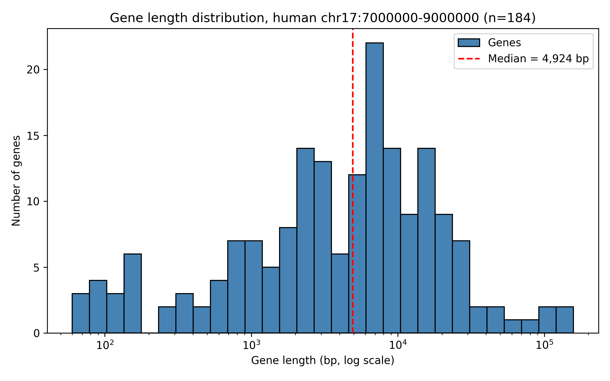
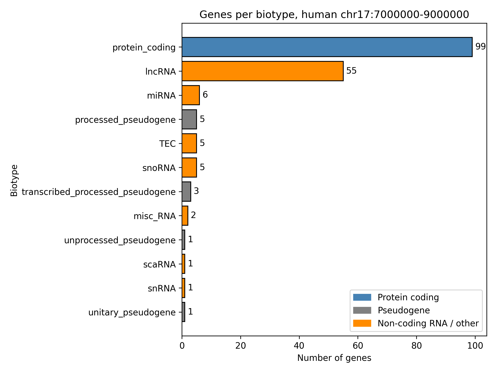

# Final Project Report: Genes on Human Chromosome 17

## Workflow

For this project I looked at a 2 Mb region of human chromosome 17 (7,000,000 to 9,000,000), which is where the TP53 gene is. I used the Ensembl REST API with Python's requests library to get all the genes in that region. The raw data was saved as data.json, and I also saved a simpler table with the gene ID, name, biotype, start, end and strand as data.csv.

Then I did two analyses. First, I calculated the length of each gene (end - start + 1) and looked at the summary stats, overall and by biotype. Second, I counted how many genes there were of each biotype. Finally I made two plots with matplotlib.

## Findings

I got 184 genes in total. Most of them were protein coding (99 genes, about 54%), and the second biggest group was lncRNAs (55 genes, about 30%). The rest were small RNAs like miRNAs and snoRNAs, some pseudogenes, and a few TEC genes.

Gene lengths were very different. The shortest gene was 60 bp and the longest was 158,099 bp. The median was 4,924 bp but the mean was 10,897 bp, so a few really long genes pull the average up. When I looked by biotype, protein coding genes had a median of about 7,600 bp, lncRNAs about 2,900 bp, and the small RNAs were all under 140 bp.

Figure 1 shows the distribution of gene lengths. I used a log scale because the lengths go from tens of bases to more than a hundred thousand. Most genes are between about 1,500 and 11,000 bp. The small group on the left are the short RNAs. The red line is the median.

Figure 2 shows the number of genes per biotype. Protein coding genes and lncRNAs clearly dominate the region, and most of the other categories only have 1 to 6 genes.

Overall, the gene length seems to depend a lot on the type of gene. Protein coding genes are longer, probably because they have introns, while small RNAs are very short. It was also interesting to see how many lncRNAs there are, since that means a big part of this region is transcribed even if it doesn't make proteins.

One limitation is that I only looked at one region, so this might not be the same for the whole genome. Also, genes that are only partly inside the region were included.

